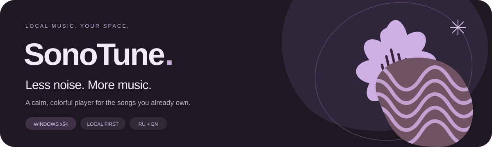

<p align="center">
  
</p>

<p align="center">
  <strong>A quiet home for your music.</strong><br />
  A local music player for Windows, built around a pleasant interface, quick access to your songs, and lightweight native playback.
</p>

<p align="center">
  <a href="https://github.com/darkl-dot/SonoTune-Music-Player/releases/latest">Download for Windows</a>
  &nbsp; · &nbsp;
  <a href="#features">Features</a>
  &nbsp; · &nbsp;
  <a href="#development">Build from source</a>
  &nbsp; · &nbsp;
  <a href="CHANGELOG.md">What's new</a>
</p>

---

SonoTune plays the music you already own. Add a folder, choose a song, and settle in.
No account, streaming subscription, or cloud library is required.

Its Material You-inspired design combines colors drawn from album artwork, soft shapes,
rounded controls, gentle motion, and a wavy playback bar. Underneath, a Rust audio engine
handles playback while virtualized lists keep large libraries manageable.

**Current release:** 0.5.0 · **Platform:** Windows x64 · **Interface:** English and Russian

## Get started

1. Open the [latest release](https://github.com/darkl-dot/SonoTune-Music-Player/releases/latest).
2. Download **SonoTune-Windows.zip** and extract the entire archive.
3. Run **SonoTune.exe**, keeping the accompanying DLLs, licenses, and `demo` folder beside it.
4. Choose your language and use **Add folder** to import your local music.

No installer is needed. Microsoft Edge WebView2 Runtime is required for the interface.
You can also try the six bundled, original demo tracks before importing your own files.

To update, close SonoTune, extract the new release, and run its executable.
Your library and preferences are stored separately from the application folder.

## Features

| Your music                                         | Your listening space                             |
| -------------------------------------------------- | ------------------------------------------------ |
| MP3, FLAC, WAV, Ogg Vorbis, and Ogg Opus           | Adaptive artwork colors and three fixed palettes |
| Recursive folder import and incremental rescanning | Light, dark, and system appearance               |
| Search by title, artist, or album                  | A customizable Home page with optional banner    |
| Artists, albums, genres, favorites, and playlists  | Recent, most-played, and random song cards       |
| Custom playlist covers                             | Pinned tracks with optional personal captions    |
| Metadata and artwork editing                       | Bundled fonts and reduced-motion support         |

### Pick up where you left off

SonoTune remembers the selected track, queue, position, volume, shuffle, and playback mode.
It opens **paused**; press Play when you are ready. Startup can open any library section,
a specific playlist, or the last section you visited.

Click the song title in the bottom player to find and highlight it in All tracks.

### A queue you can shape

Drag songs to reorder them, use the move buttons, remove individual entries, or clear
upcoming tracks. Editing the queue preserves the current song and its playback position.
The currently selected song stays in the queue.

The playback-mode button cycles through four choices:

| Mode                 | At the end                   |
| -------------------- | ---------------------------- |
| One track            | Stop after this song         |
| Play list            | Stop at the end of the queue |
| Repeat current track | Play this song again         |
| Repeat current list  | Restart the queue            |

Hover over the button to see the full menu, or open it with Enter or an arrow key.
Manual Next and Previous remain available in every mode.

### Keep your library up to date

Added folders are checked at every startup. Optionally, set a background scan interval
in minutes in Settings. Scans read metadata for new or changed files rather than reparsing
every unchanged recording. Missing files remain visible as unavailable, preserving
playlist references. An unavailable drive does not empty your library.

### At home in Windows

Native Windows media-session integration publishes the current title, artist, album,
cover, playback state, and timeline. System playback controls and compatible media
flyouts can control the same player engine.

### Edit metadata locally

Edit title, artists, album, year, genres, and artwork. Direct file writes create a backup
and verify the audio data before replacing the original. A JSON sidecar is available as
an alternative. Ogg/Opus metadata uses its container's tags rather than MP3 ID3 tags.

## Keyboard shortcuts

| Action                           | Shortcut                   |
| -------------------------------- | -------------------------- |
| Search                           | `Ctrl+K`                   |
| Play / pause                     | `Space`                    |
| Stop and return to the beginning | `Shift+Space`              |
| Next / previous                  | `Ctrl+Right` / `Ctrl+Left` |
| Close a dialog or menu           | `Esc`                      |

Playback shortcuts apply when focus is outside inputs, buttons, and dialogs.
Previous restarts the current song if more than three seconds have elapsed.

## Local data

On Windows, application data lives in `%APPDATA%\app.sonotune.player\`:

- `library.sqlite`: tracks, folders, favorites, playlists, listening statistics, pins, and playback snapshots.
- `artwork/`: cached album artwork.
- `backups/`: original files saved before direct metadata edits. Backups are not automatically removed.
- `demo/`: demo recordings copied into the library when requested.

Interface preferences use the local WebView storage. A sidecar is stored next to its
audio file, for example `song.flac.sonotune.json`.

Removing a song from the library does **not** delete its audio file. SonoTune does not
upload your music or library to a service. Fonts are bundled for offline use: **Nunito**
for Russian and **Varela Round** for English, with Nunito providing Cyrillic fallback.

## Development

The application uses **Tauri 2, React, TypeScript, Vite, Zustand, and Rust**. Its controls
are custom components, without a heavyweight UI component library. Playback uses Rodio
and Symphonia, with libopus for Ogg Opus. Metadata uses Lofty; persistence uses SQLite.

For Windows development, install Node.js 22 or newer, pnpm 11, a current stable Rust
toolchain, CMake, and the native tools required by
[Tauri's Windows prerequisites](https://v2.tauri.app/start/prerequisites/#windows).
The supplied release was built with Rust 1.99 and LLVM-MinGW. A standard MSVC build uses
the Visual Studio C++ build tools instead; platform/toolchain dependencies may differ.

```sh
git clone https://github.com/darkl-dot/SonoTune-Music-Player.git
cd SonoTune-Music-Player
pnpm install --frozen-lockfile
pnpm desktop
```

For the browser preview, run `pnpm dev`. Browser playback depends on the browser's
codecs; it stores imported files in IndexedDB, exports tag edits as JSON, and cannot
automatically revisit a previously selected folder like the desktop app.

### Checks and production build

```sh
pnpm test
pnpm build
cargo test --manifest-path src-tauri/Cargo.toml --lib
pnpm desktop:build
```

The Windows media-session integration test is opt-in because it creates a real temporary
system media session:

```sh
cargo test --manifest-path src-tauri/Cargo.toml --lib native_session_round_trip -- --ignored --nocapture
```

See [verification notes](VERIFICATION.md) for what was tested and its limits, and
[CONTRIBUTING.md](CONTRIBUTING.md) for development guidance.
Portable packaging is described in [the release guide](docs/releasing.md).

## Project structure

```text
src/
  app/                Window layout, settings, navigation, and state
  features/           Home, library, playlists, player, and tag editor
  shared/             UI primitives, types, translations, and environment adapters
src-tauri/src/        Audio, scanning, metadata, SQLite, and Windows media integration
tests/               Frontend tests and synthetic audio fixtures
public/              Offline fonts, app icon, and original demo recordings
docs/                Behavior specifications and repository artwork
```

## Current boundaries

Windows is the supported release platform. Linux and macOS builds are future work.
Ogg Opus supports mono and stereo; multichannel Opus, gapless playback, crossfade,
and real-time filesystem watching are not implemented. Renaming or moving a file
outside the app imports it as a new library entry at the next scan.

Lightweight operation and smooth interaction are design goals, not a claim of measured
60 FPS or a fixed memory footprint. Lists are virtualized, but library metadata is
currently held in the frontend as a whole. Playback checkpoints are saved periodically
and at normal shutdown; a crash may lose the most recent few seconds.

## Credits and licensing

SonoTune has not yet been assigned an open-source license. Dependencies retain their
own licenses. Nunito and Varela Round are distributed under the SIL Open Font License
1.1; their notices are included in `public/fonts/` and the Windows download.
The bundled demo recordings and synthetic test audio were created for SonoTune and
are provided under CC0. Repository artwork is generated locally as SVG.
