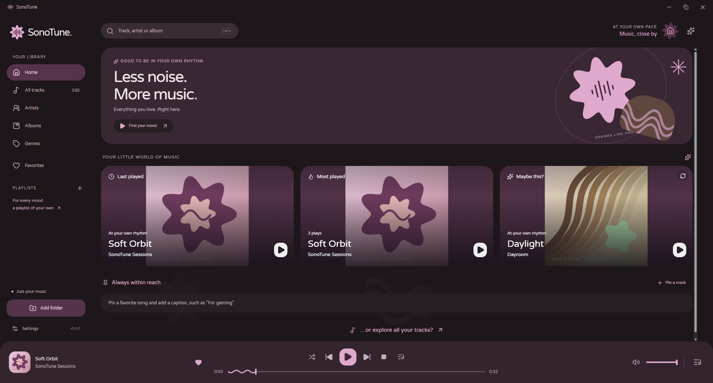
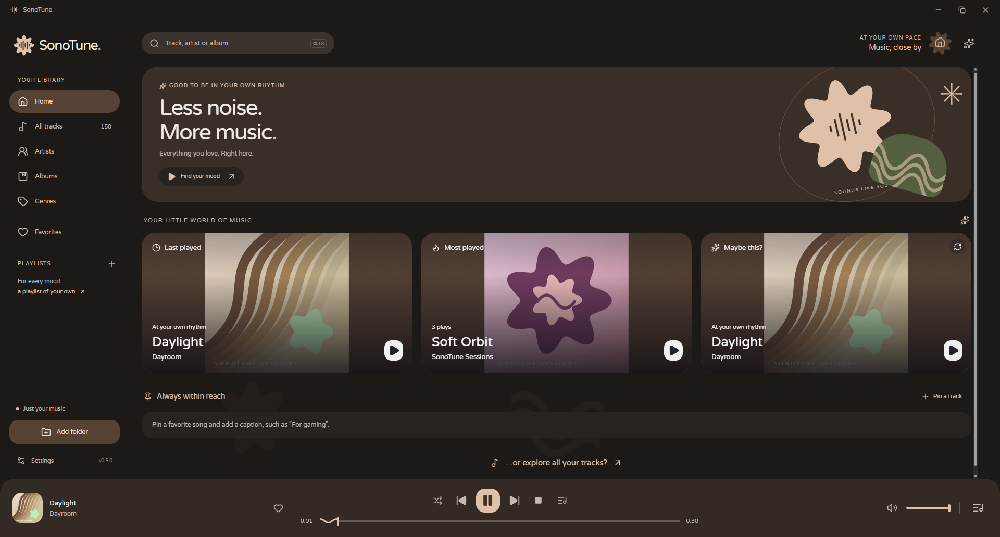

  

  A local music player for Windows. Adaptive colors, a wavy player bar, and your own music.

  
   
  &nbsp; · &nbsp;
  <a href="docs/user-guide.md">User guide</a>
  &nbsp; · &nbsp;
  <a href="docs/development.md">Build from source</a>

  
   
  Home · lilac palette. Screenshots were captured before the v1 wording update.

  
See the warm palette

  

    
     
    The same Home page with a warm palette. Both screenshots use dark appearance.
  

## Play your music

Download **SonoTune-Windows.zip** from the release, extract it, and run **SonoTune.exe**.
Keep the accompanying DLLs and folders beside it. Choose your language, add a music
folder, and press Play. Windows x64 and Microsoft Edge WebView2 Runtime are required.

## Features

- **Your local library:** MP3, FLAC, WAV, Ogg Vorbis, and Ogg Opus; search by title, artist, or album.
- **A look you can change:** artwork colors, fixed palettes, light/dark appearance, and gentle motion.
- **Your way to listen:** playlists with custom covers, favorites, pinned tracks, and an editable queue.
- **Pick up later:** saved playback position and queue, restored on pause; choose your startup page.
- **Windows integration:** track information, artwork, and controls in the system media session.
- **Local tools:** metadata editing with backups, folder rescanning, offline English/Russian fonts.

No account or cloud library required. Windows is the current release platform.

## More

- [User guide](docs/user-guide.md) — playback modes, shortcuts, library updates, and local data.
- [Development](docs/development.md) — prerequisites, build commands, and project structure.
- [Changelog](CHANGELOG.md) · [Verification](VERIFICATION.md) · [Contributing](CONTRIBUTING.md)

Licensed under [MIT](LICENSE). Bundled fonts and dependencies retain their own licenses.
