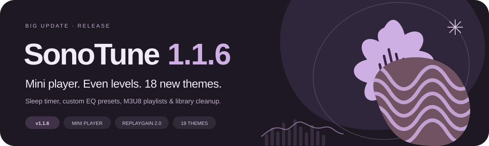

  

# SonoTune v1.1.6 — Big Update

This is the biggest update SonoTune has had since v1. It started as a focused audio-quality release and grew into a full upgrade across playback, appearance, library housekeeping, and everyday ergonomics — still local-first, still lightweight, still no accounts or cloud.

## What's new

### Always-on-top Mini Player & live visualizer
You can now pop SonoTune out into a compact floating window right from the player bar (the icon just left of Volume). It stays on top while you work or game, drags from anywhere on the card, and keeps the essentials on hover — favorite, previous, centered play/pause, next, the full repeat-mode menu, and a slim seek bar along the bottom edge.

Under the artwork sits a real-time 32-band FFT spectrum visualizer. Open **Settings → Mini player** to preview it live, toggle always-on-top, turn the blurred artwork glow and gentle backdrop drift on or off, and pick your visualizer style: **Off**, **Bars**, **Wave**, or **Bars & wave**.

### Volume leveling & overload protection
No more jumping for the volume knob between quiet albums and loud singles, and no more clipping when you push the equalizer:
- **Brickwall limiter (−1 dBFS).** A stereo-linked limiter now sits on the summed output bus after the equalizer and crossfade, so both sides of a crossfade share one clean gain envelope. Below the ceiling it stays transparent; if you prefer a bit-exact chain, you can turn it off in **Settings → Audio**.
- **ReplayGain 2.0 / EBU R128 leveling (−18 LUFS).** Choose **Off**, **Per track**, or **Per album** in **Settings → Audio**. Embedded `REPLAYGAIN_*` tags are used directly without re-decoding; everything else is measured quietly in the background and cached in `library.sqlite`, with true-peak capping and smooth gain transitions when you switch modes mid-song.

### Everyday playback & workflow upgrades
- **Sleep timer.** Click the moon icon on the player bar to stop after 15, 30, 45, or 60 minutes (with a gentle 10-second fade-out that restores your volume afterward), or choose **After this track** so the current song finishes cleanly.
- **Custom equalizer presets.** Save and delete your own EQ curves (for headphones, speakers, late-night listening, etc.) right alongside the five built-in presets.
- **Explorer drag-and-drop & “Show in Explorer”.** Drop a folder straight onto SonoTune to add and scan it; drop audio files to import and play them right away. Any track's context menu also has **Show in Explorer** to jump straight to the file on disk.
- **M3U / M3U8 playlists.** Export any playlist to `.m3u8` for backup or sharing, and import `.m3u` / `.m3u8` playlists into your library (including UTF-8 BOM and relative paths).
- **Quick volume controls.** Right-click the volume icon to switch Windows output devices without opening Settings, and scroll the mouse wheel over the volume slider (5% steps, or 1% with Shift).

### Smarter library & housekeeping
- **Real-time folder watching.** Scheduled scan intervals are gone — SonoTune now watches your music folders continuously, debounces bursts, and rescans only what actually changed.
- **Forget a folder.** Remove any music folder from **Settings → Library** with confirmation: its tracks leave the library and queue, the watcher stops following it, and your files on disk stay untouched.
- **Library health.** A new housekeeping block in **Settings → Library** highlights missing files (`available: false`) and duplicate tracks (automatically keeping the best copy by favorite status, format quality, and file size) and lets you clean them out of the app in one click without ever deleting files on disk.

### 18 extra themes & a cleaner interface
- **More themes.** **Settings → Appearance** now includes 18 curated palettes — **Absolutely**, **Ayu**, **Catppuccin**, **Dracula**, **Everforest**, **GitHub**, **Gruvbox**, **Linear**, and **Lobster** — each in both dark and light variants with swatch previews.
- **Redesigned Settings.** A wider, fixed-height dialog organized into six tabs (**General**, **Appearance**, **Mini player**, **Audio**, **Library**, **Application**) with arrow-key navigation, readable hints, and portal-positioned dropdowns that never clip inside dialogs.
- **Visual polish.** Themed in-app tooltips replace harsh OS tooltips, Home highlight cards get a subtle top vignette for bright covers, and the sidebar drops redundant clutter for more breathing room.

## Download and update

Download **SonoTune-Windows.zip**, extract the entire archive, and run **SonoTune.exe**.
Keep the accompanying DLLs and folders beside it. Windows x64 and Microsoft Edge
WebView2 Runtime are required.

Before updating, choose **Quit SonoTune** from the tray menu to fully close the old
version. Your library and preferences are retained. Keep the portable app in a stable
folder; if you move it, update startup and “Open with” registration from Settings.

The release includes the portable player, source archive, MIT license, build information,
and SHA-256 checksums. Third-party license notices and offline fonts are bundled.

[Full changelog](https://github.com/darkl-dot/SonoTune-Music-Player/blob/main/CHANGELOG.md)
· [Loudness & protection notes](https://github.com/darkl-dot/SonoTune-Music-Player/blob/main/docs/loudness-and-protection.md)
· [Verification and limits](https://github.com/darkl-dot/SonoTune-Music-Player/blob/main/VERIFICATION.md)
